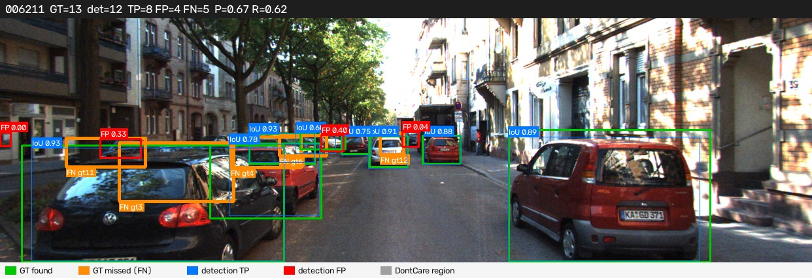

# YOLOv8 car detection on KITTI – evaluation with IoU, matching, precision & recall

Computer Vision compulsory project, RWU (Prof. Elser), Task 2.
YOLOv8 runs on 20 KITTI road scenes. Every car detection is compared with the ground truth
(IoU), detections are matched one-to-one to GT cars, and precision / recall are reported per
scene. The errors are analysed with the full KITTI labels (occlusion, truncation, DontCare).


*Green = GT car found, orange = GT car missed, blue = correct detection (with IoU),
red = wrong detection.*

## Results (YOLOv8m, conf ≥ 0.25, IoU ≥ 0.5, gated Hungarian matching)
| | TP | FP | FN | precision | recall |
|---|---|---|---|---|---|
| all 20 scenes | 78 | 40 | 20 | **0.66** | **0.80** |

* Recall is 0.98 for fully visible cars but only 0.44 for largely occluded ones. KITTI's GT
  box covers the *whole* car (also the hidden part), while YOLO boxes only the visible part.
  At IoU ≥ 0.3 their recall is 0.93.
* 9 of the 12 "false positives" without any GT object are real cars missing from the labels,
  so precision is underestimated.
* Hungarian matching **must be gated** (IoU < threshold excluded before solving), otherwise
  it can trade a good pair for two weak ones (scene 006211).

Per-scene table, every box's IoU and the full discussion: **[docs/EXAM_NOTES.md](docs/EXAM_NOTES.md)**,
[results/yolov8m/report.md](results/yolov8m/report.md), [results/ablation.md](results/ablation.md)

## Project structure
```
├── main.py                 # detection + evaluation of all scenes
├── ablation.py             # compares models, matching, IoU/confidence thresholds
├── notebooks/Task2_walkthrough.ipynb   # step by step with images under each cell
├── src/
│   ├── kitti.py            # dataset loading (labels, K, full KITTI labels)
│   ├── detector.py         # YOLOv8 wrapper (ultralytics)
│   ├── matching.py         # IoU, greedy / Hungarian matching, precision & recall
│   ├── evaluation.py       # per-scene evaluation + reason for every FP / FN
│   └── visualize.py        # drawing
├── data/                   # KITTI_Selection (from Moodle, not in git)
├── models/                 # YOLO weights (downloaded automatically)
├── results/yolov8m/        # scenes/*.jpg, per_scene.csv, per_detection.csv, per_gt.csv, report.md
└── docs/EXAM_NOTES.md
```

## Setup (Ubuntu)
```bash
cd ~/Projects/CV_Task_2
python3 -m venv .venv
source .venv/bin/activate
pip install -r requirements.txt
```
Data (see `data/README.md`):
```bash
CV=~/Documents/RWU_2026-2027/"Computer Vision"
cp -r "$CV/KITTI_Selection" data/
mkdir -p data/KITTI_full_labels
cp "$CV"/KITTI-Selection_incl_LiDAR_2026/KITTI-Selection/data_object_label_2/training/label_2/*.txt data/KITTI_full_labels/
```

## Run
```bash
python main.py                         # results/yolov8m/
python main.py --model models/yolov8s.pt --match greedy --iou-thr 0.7 --out results/test
python ablation.py                     # results/ablation.md + pr_curve.png
```
In VS Code: Run and Debug → "Task 2: evaluate (YOLOv8m)", or open the notebook → Run All.
Open `results/yolov8m/report.md` with **Ctrl+K V** to see all scenes with their tables.
