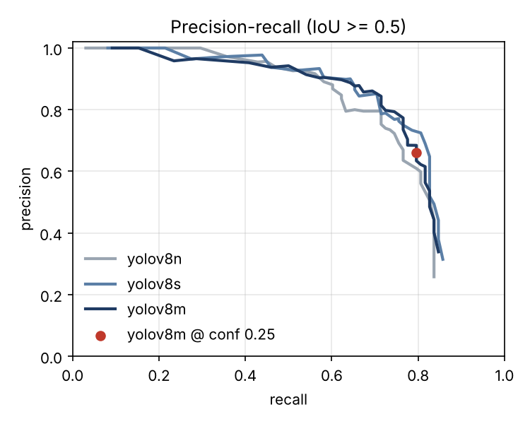

# Task 2 - how the evaluation choices change the result

All numbers summed over the 20 scenes (micro average). Default setting in **bold**: YOLOv8m, confidence >= 0.25, IoU >= 0.5, gated Hungarian matching, class car only.

## Model size

| setting | TP | FP | FN | precision | recall |
|---|---|---|---|---|---|
| yolov8n | 73 | 29 | 25 | 0.72 | 0.74 |
| yolov8s | 79 | 33 | 19 | 0.71 | 0.81 |
| **yolov8m** | 78 | 40 | 20 | 0.66 | 0.80 |

## Matching strategy

| setting | TP | FP | FN | precision | recall |
|---|---|---|---|---|---|
| **Hungarian (gated)** | 78 | 40 | 20 | 0.66 | 0.80 |
| greedy by confidence | 78 | 40 | 20 | 0.66 | 0.80 |
| Hungarian without gating | 76 | 42 | 22 | 0.64 | 0.78 |

## IoU threshold

| setting | TP | FP | FN | precision | recall |
|---|---|---|---|---|---|
| 0.3 | 87 | 31 | 11 | 0.74 | 0.89 |
| **0.5** | 78 | 40 | 20 | 0.66 | 0.80 |
| 0.7 | 60 | 58 | 38 | 0.51 | 0.61 |

## Classes counted as car

| setting | TP | FP | FN | precision | recall |
|---|---|---|---|---|---|
| **car** | 78 | 40 | 20 | 0.66 | 0.80 |
| car + truck | 79 | 55 | 19 | 0.59 | 0.81 |

## Recall per occlusion level (KITTI: 0 visible, 1 partly, 2 largely occluded, 3 unknown)

| occlusion | GT cars | found | recall | found with IoU >= 0.3 |
|---|---|---|---|---|
| 0 | 45 | 44 | 0.98 | 0.98 |
| 1 | 18 | 16 | 0.89 | 0.94 |
| 2 | 27 | 12 | 0.44 | 0.93 |
| 3 | 8 | 6 | 0.75 | 0.88 |

## Precision / recall vs. confidence threshold (YOLOv8m)

| conf | detections | precision | recall |
|---|---|---|---|
| 0.05 | 198 | 0.41 | 0.84 |
| 0.1 | 160 | 0.51 | 0.83 |
| **0.25** | 118 | 0.66 | 0.80 |
| 0.4 | 93 | 0.80 | 0.76 |
| 0.5 | 82 | 0.84 | 0.70 |
| 0.6 | 74 | 0.88 | 0.66 |
| 0.7 | 63 | 0.90 | 0.58 |
| 0.8 | 44 | 0.95 | 0.43 |
| 0.9 | 9 | 1.00 | 0.09 |

