# Task 2 - YOLOv8 evaluation on KITTI_Selection

Model `yolov8m.pt`, confidence >= 0.25, IoU threshold 0.5, matching **hungarian**, classes: car only

Colours: green = GT car found, orange = GT car missed (FN), blue = correct detection (TP), red = wrong detection (FP), grey dashed = KITTI DontCare region.

## Per scene

| scene | gt_cars | detections | TP | FP | FN | precision | recall | mean_IoU_TP |
|---|---|---|---|---|---|---|---|---|
| 006037 | 5 | 6 | 4 | 2 | 1 | 0.67 | 0.80 | 0.68 |
| 006042 | 2 | 3 | 2 | 1 | 0 | 0.67 | 1.00 | 0.84 |
| 006048 | 6 | 6 | 5 | 1 | 1 | 0.83 | 0.83 | 0.86 |
| 006054 | 8 | 10 | 6 | 4 | 2 | 0.60 | 0.75 | 0.77 |
| 006059 | 6 | 7 | 6 | 1 | 0 | 0.86 | 1.00 | 0.75 |
| 006067 | 5 | 5 | 4 | 1 | 1 | 0.80 | 0.80 | 0.86 |
| 006097 | 6 | 10 | 6 | 4 | 0 | 0.60 | 1.00 | 0.80 |
| 006098 | 4 | 4 | 4 | 0 | 0 | 1.00 | 1.00 | 0.82 |
| 006121 | 0 | 0 | 0 | 0 | 0 | n/a | n/a | n/a |
| 006130 | 0 | 1 | 0 | 1 | 0 | 0.00 | n/a | n/a |
| 006206 | 1 | 1 | 1 | 0 | 0 | 1.00 | 1.00 | 0.77 |
| 006211 | 13 | 12 | 8 | 4 | 5 | 0.67 | 0.62 | 0.84 |
| 006227 | 2 | 2 | 2 | 0 | 0 | 1.00 | 1.00 | 0.83 |
| 006253 | 6 | 7 | 4 | 3 | 2 | 0.57 | 0.67 | 0.78 |
| 006291 | 12 | 12 | 7 | 5 | 5 | 0.58 | 0.58 | 0.78 |
| 006310 | 7 | 7 | 6 | 1 | 1 | 0.86 | 0.86 | 0.76 |
| 006312 | 8 | 9 | 6 | 3 | 2 | 0.67 | 0.75 | 0.84 |
| 006315 | 2 | 9 | 2 | 7 | 0 | 0.22 | 1.00 | 0.80 |
| 006329 | 3 | 5 | 3 | 2 | 0 | 0.60 | 1.00 | 0.78 |
| 006374 | 2 | 2 | 2 | 0 | 0 | 1.00 | 1.00 | 0.90 |
| ALL (micro) | 98 | 118 | 78 | 40 | 20 | 0.66 | 0.80 | 0.80 |
| mean over scenes (macro) |  |  |  |  |  | 0.69 | 0.87 |  |

*n/a = undefined (0/0): a scene without GT cars has no recall; a scene without detections has no precision.*

## Why detections were wrong (FP)

* 16 x poor localisation
* 8 x inside KITTI 'DontCare' region
* 8 x no GT object here - unlabelled car or false alarm
* 4 x small, unlabelled object
* 3 x Van in full KITTI labels
* 1 x duplicate

## Why GT cars were missed (FN)

* 15 x found, but box overlaps only with IoU < 0.5  [largely occluded]
* 2 x found, but box overlaps only with IoU < 0.5  [not occluded/unknown]
* 1 x detected as 'truck'  [not occluded/unknown]
* 1 x not detected  [partly occluded]
* 1 x found, but box overlaps only with IoU < 0.5  [partly occluded]

## Scenes

### 006037  -  P=0.67  R=0.80

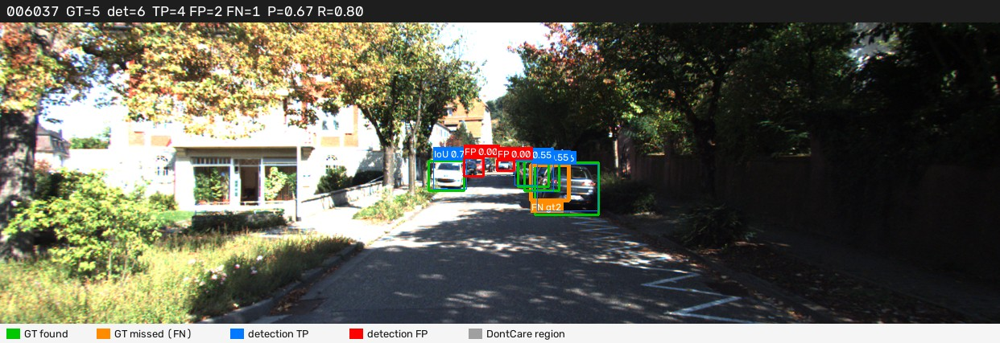

| what | status | conf | iou | gt | reason |
|---|---|---|---|---|---|
| det 0 | TP | 0.868 | 0.86 | 0 |  |
| det 1 | TP | 0.824 | 0.76 | 1 |  |
| det 2 | TP | 0.544 | 0.551 | 3 |  |
| det 3 | TP | 0.522 | 0.551 | 4 |  |
| det 4 | FP | 0.492 | 0.003 | 1 | inside KITTI 'DontCare' region (unlabelled far/hidden vehicle) |
| det 5 | FP | 0.336 | 0.0 |  | inside KITTI 'DontCare' region (unlabelled far/hidden vehicle) |
| GT 2 | FN |  | 0.427 | 2 | car detection overlaps only with IoU 0.43 < 0.5, largely occluded |

### 006042  -  P=0.67  R=1.00

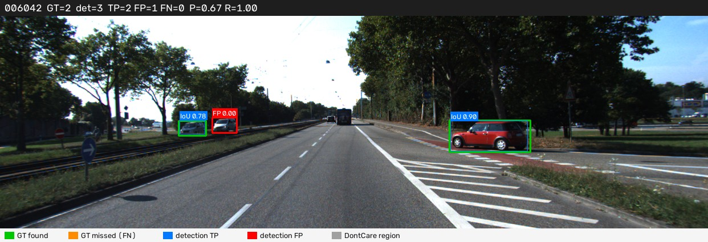

| what | status | conf | iou | gt | reason |
|---|---|---|---|---|---|
| det 0 | TP | 0.86 | 0.899 | 0 |  |
| det 1 | TP | 0.747 | 0.782 | 1 |  |
| det 2 | FP | 0.659 | 0.0 |  | Van in full KITTI labels (not a 'Car') |

### 006048  -  P=0.83  R=0.83

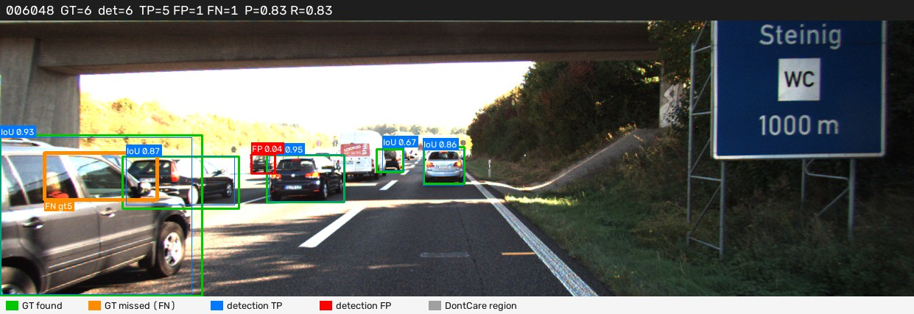

| what | status | conf | iou | gt | reason |
|---|---|---|---|---|---|
| det 0 | TP | 0.831 | 0.954 | 3 |  |
| det 1 | TP | 0.815 | 0.863 | 0 |  |
| det 2 | TP | 0.682 | 0.868 | 2 |  |
| det 3 | TP | 0.668 | 0.93 | 1 |  |
| det 4 | FP | 0.634 | 0.037 | 3 | inside KITTI 'DontCare' region (unlabelled far/hidden vehicle) |
| det 5 | TP | 0.447 | 0.671 | 4 |  |
| GT 5 | FN |  | 0.176 | 5 | car detection overlaps only with IoU 0.18 < 0.5, largely occluded |

### 006054  -  P=0.60  R=0.75

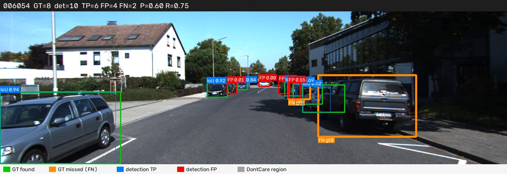

| what | status | conf | iou | gt | reason |
|---|---|---|---|---|---|
| det 0 | TP | 0.893 | 0.935 | 1 |  |
| det 1 | TP | 0.836 | 0.921 | 2 |  |
| det 2 | TP | 0.828 | 0.618 | 3 |  |
| det 3 | TP | 0.614 | 0.843 | 7 |  |
| det 4 | FP | 0.583 | 0.01 | 2 | no GT object here - unlabelled car or false alarm (check image) |
| det 5 | TP | 0.579 | 0.692 | 4 |  |
| det 6 | FP | 0.419 | 0.178 | 6 | poor localisation (IoU 0.18 with GT car 6) |
| det 7 | TP | 0.379 | 0.629 | 6 |  |
| det 8 | FP | 0.364 | 0.554 | 6 | duplicate (GT car 6 already matched) |
| det 9 | FP | 0.358 | 0.0 |  | inside KITTI 'DontCare' region (unlabelled far/hidden vehicle) |
| GT 0 | FN |  | 0.049 | 0 | detected as 'truck' (IoU 0.86) |
| GT 5 | FN |  | 0.492 | 5 | car detection overlaps only with IoU 0.49 < 0.5, largely occluded |

### 006059  -  P=0.86  R=1.00

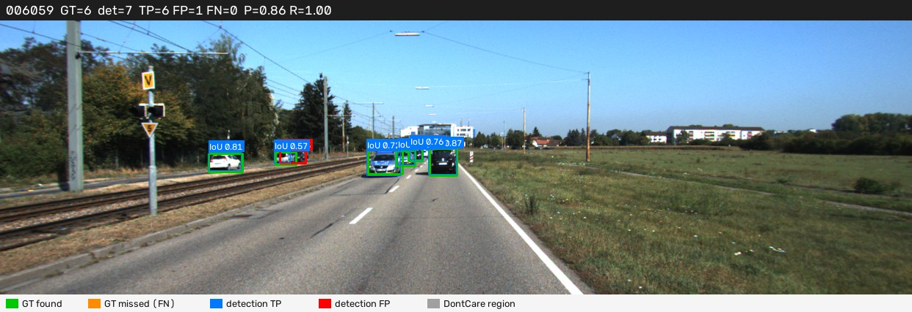

| what | status | conf | iou | gt | reason |
|---|---|---|---|---|---|
| det 0 | TP | 0.856 | 0.866 | 5 |  |
| det 1 | TP | 0.797 | 0.809 | 1 |  |
| det 2 | TP | 0.732 | 0.721 | 0 |  |
| det 3 | TP | 0.5 | 0.766 | 2 |  |
| det 4 | FP | 0.339 | 0.425 | 3 | poor localisation (IoU 0.43 with GT car 3) |
| det 5 | TP | 0.331 | 0.574 | 3 |  |
| det 6 | TP | 0.29 | 0.759 | 4 |  |

### 006067  -  P=0.80  R=0.80

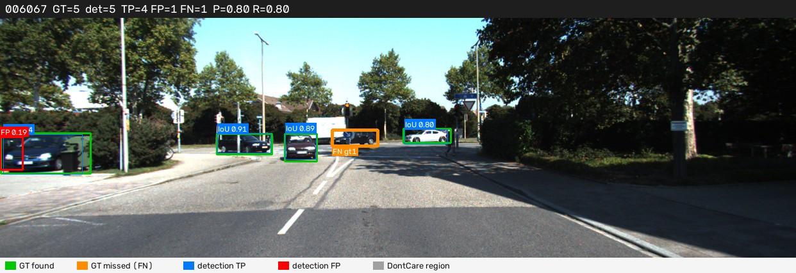

| what | status | conf | iou | gt | reason |
|---|---|---|---|---|---|
| det 0 | TP | 0.817 | 0.889 | 0 |  |
| det 1 | TP | 0.813 | 0.906 | 2 |  |
| det 2 | TP | 0.75 | 0.843 | 3 |  |
| det 3 | TP | 0.624 | 0.797 | 4 |  |
| det 4 | FP | 0.496 | 0.192 | 3 | poor localisation (IoU 0.19 with GT car 3) |
| GT 1 | FN |  | 0.0 | 1 | not detected, partly occluded, small (24 px high), far away (44 m) |

### 006097  -  P=0.60  R=1.00

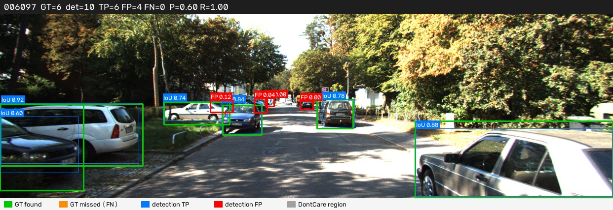

| what | status | conf | iou | gt | reason |
|---|---|---|---|---|---|
| det 0 | TP | 0.908 | 0.924 | 3 |  |
| det 1 | TP | 0.873 | 0.883 | 5 |  |
| det 2 | TP | 0.847 | 0.604 | 4 |  |
| det 3 | TP | 0.81 | 0.842 | 2 |  |
| det 4 | TP | 0.762 | 0.739 | 0 |  |
| det 5 | TP | 0.738 | 0.782 | 1 |  |
| det 6 | FP | 0.59 | 0.0 |  | inside KITTI 'DontCare' region (unlabelled far/hidden vehicle) |
| det 7 | FP | 0.332 | 0.0 |  | inside KITTI 'DontCare' region (unlabelled far/hidden vehicle) |
| det 8 | FP | 0.309 | 0.044 | 2 | no GT object here - unlabelled car or false alarm (check image) |
| det 9 | FP | 0.258 | 0.124 | 0 | poor localisation (IoU 0.12 with GT car 0) |

### 006098  -  P=1.00  R=1.00

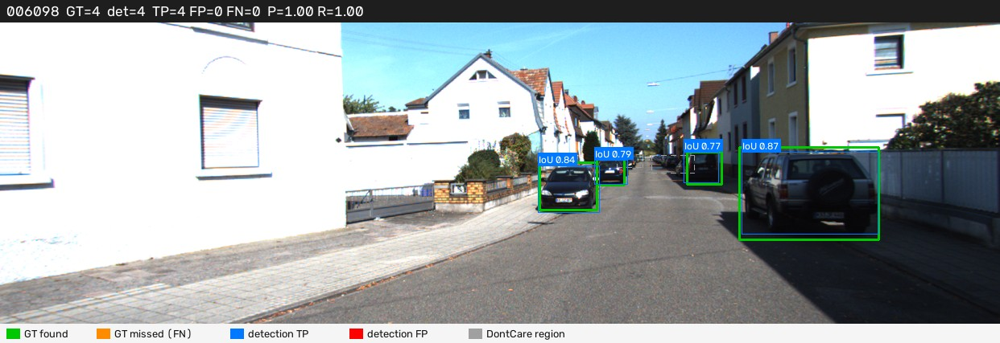

| what | status | conf | iou | gt | reason |
|---|---|---|---|---|---|
| det 0 | TP | 0.859 | 0.835 | 1 |  |
| det 1 | TP | 0.756 | 0.785 | 2 |  |
| det 2 | TP | 0.652 | 0.873 | 0 |  |
| det 3 | TP | 0.293 | 0.767 | 3 |  |

### 006121  -  P=n/a  R=n/a

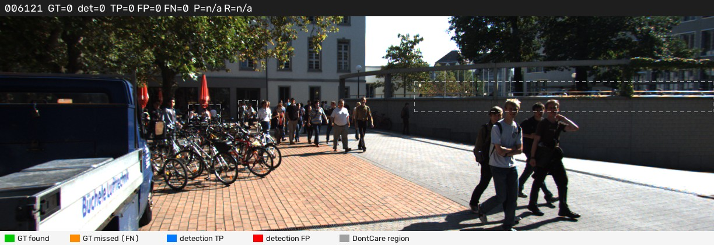

### 006130  -  P=0.00  R=n/a

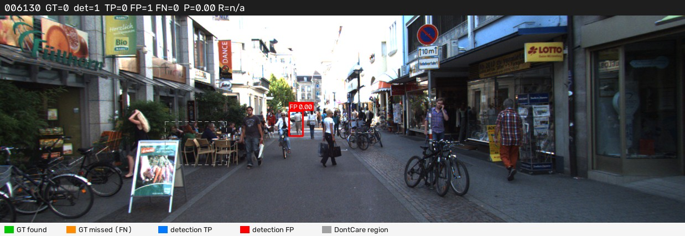

| what | status | conf | iou | gt | reason |
|---|---|---|---|---|---|
| det 0 | FP | 0.251 | 0.0 |  | no GT object here - unlabelled car or false alarm (check image) |

### 006206  -  P=1.00  R=1.00

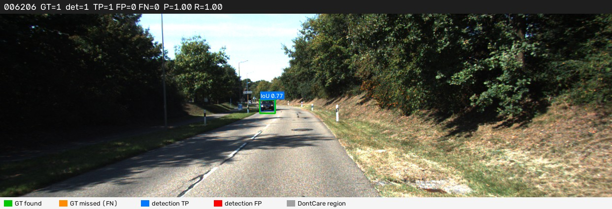

| what | status | conf | iou | gt | reason |
|---|---|---|---|---|---|
| det 0 | TP | 0.684 | 0.769 | 0 |  |

### 006211  -  P=0.67  R=0.62

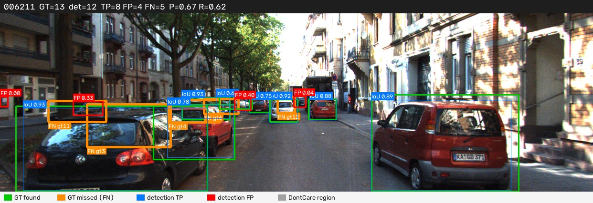

| what | status | conf | iou | gt | reason |
|---|---|---|---|---|---|
| det 0 | TP | 0.909 | 0.888 | 9 |  |
| det 1 | TP | 0.9 | 0.931 | 1 |  |
| det 2 | TP | 0.854 | 0.884 | 10 |  |
| det 3 | TP | 0.842 | 0.915 | 0 |  |
| det 4 | TP | 0.803 | 0.752 | 7 |  |
| det 5 | TP | 0.735 | 0.777 | 2 |  |
| det 6 | FP | 0.668 | 0.334 | 11 | poor localisation (IoU 0.33 with GT car 11) |
| det 7 | TP | 0.422 | 0.934 | 5 |  |
| det 8 | TP | 0.413 | 0.605 | 8 |  |
| det 9 | FP | 0.376 | 0.395 | 8 | poor localisation (IoU 0.40 with GT car 8) |
| det 10 | FP | 0.323 | 0.0 |  | small, unlabelled object (21 px high) - possibly a real car missing in GT |
| det 11 | FP | 0.302 | 0.042 | 0 | small, unlabelled object (23 px high) - possibly a real car missing in GT |
| GT 3 | FN |  | 0.211 | 3 | car detection overlaps only with IoU 0.21 < 0.5, largely occluded |
| GT 4 | FN |  | 0.491 | 4 | car detection overlaps only with IoU 0.49 < 0.5, largely occluded |
| GT 6 | FN |  | 0.424 | 6 | car detection overlaps only with IoU 0.42 < 0.5, largely occluded |
| GT 11 | FN |  | 0.334 | 11 | car detection overlaps only with IoU 0.33 < 0.5, largely occluded |
| GT 12 | FN |  | 0.339 | 12 | car detection overlaps only with IoU 0.34 < 0.5, largely occluded |

### 006227  -  P=1.00  R=1.00

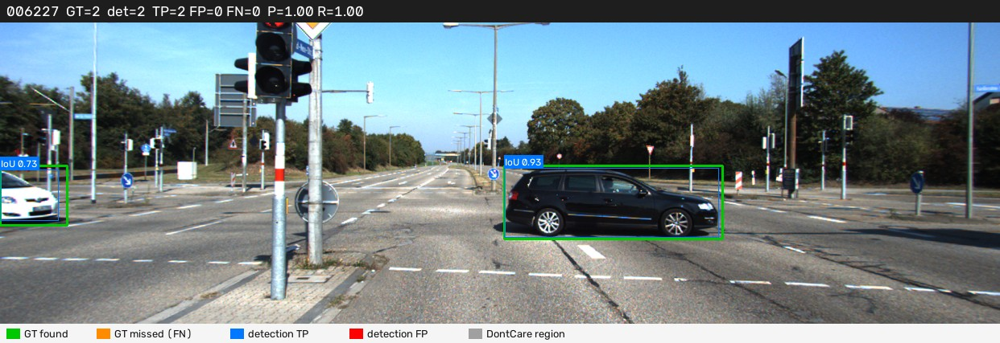

| what | status | conf | iou | gt | reason |
|---|---|---|---|---|---|
| det 0 | TP | 0.903 | 0.932 | 0 |  |
| det 1 | TP | 0.875 | 0.728 | 1 |  |

### 006253  -  P=0.57  R=0.67

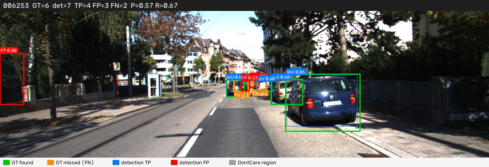

| what | status | conf | iou | gt | reason |
|---|---|---|---|---|---|
| det 0 | TP | 0.915 | 0.856 | 2 |  |
| det 1 | TP | 0.829 | 0.685 | 3 |  |
| det 2 | TP | 0.805 | 0.889 | 0 |  |
| det 3 | FP | 0.452 | 0.301 | 5 | poor localisation (IoU 0.30 with GT car 5) |
| det 4 | FP | 0.426 | 0.0 |  | no GT object here - unlabelled car or false alarm (check image) |
| det 5 | TP | 0.401 | 0.683 | 4 |  |
| det 6 | FP | 0.267 | 0.329 | 1 | poor localisation (IoU 0.33 with GT car 1) |
| GT 1 | FN |  | 0.367 | 1 | car detection overlaps only with IoU 0.37 < 0.5, largely occluded |
| GT 5 | FN |  | 0.38 | 5 | car detection overlaps only with IoU 0.38 < 0.5, largely occluded |

### 006291  -  P=0.58  R=0.58

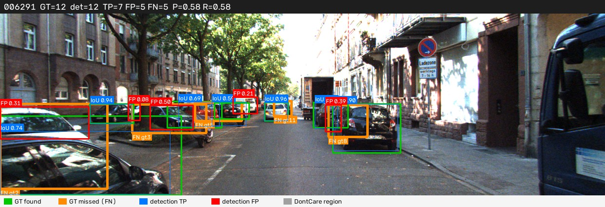

| what | status | conf | iou | gt | reason |
|---|---|---|---|---|---|
| det 0 | TP | 0.903 | 0.742 | 1 |  |
| det 1 | TP | 0.896 | 0.901 | 7 |  |
| det 2 | TP | 0.866 | 0.945 | 10 |  |
| det 3 | TP | 0.826 | 0.96 | 0 |  |
| det 4 | TP | 0.794 | 0.631 | 9 |  |
| det 5 | TP | 0.772 | 0.693 | 4 |  |
| det 6 | FP | 0.741 | 0.307 | 2 | poor localisation (IoU 0.31 with GT car 2) |
| det 7 | FP | 0.739 | 0.495 | 3 | poor localisation (IoU 0.50 with GT car 3) |
| det 8 | TP | 0.655 | 0.589 | 6 |  |
| det 9 | FP | 0.383 | 0.084 | 10 | no GT object here - unlabelled car or false alarm (check image) |
| det 10 | FP | 0.372 | 0.391 | 9 | poor localisation (IoU 0.39 with GT car 9) |
| det 11 | FP | 0.327 | 0.214 | 6 | poor localisation (IoU 0.21 with GT car 6) |
| GT 2 | FN |  | 0.453 | 2 | car detection overlaps only with IoU 0.45 < 0.5, truncated at image border (27%) |
| GT 3 | FN |  | 0.495 | 3 | car detection overlaps only with IoU 0.50 < 0.5, partly occluded |
| GT 5 | FN |  | 0.483 | 5 | car detection overlaps only with IoU 0.48 < 0.5, largely occluded |
| GT 8 | FN |  | 0.342 | 8 | car detection overlaps only with IoU 0.34 < 0.5, largely occluded |
| GT 11 | FN |  | 0.375 | 11 | car detection overlaps only with IoU 0.37 < 0.5, largely occluded |

### 006310  -  P=0.86  R=0.86

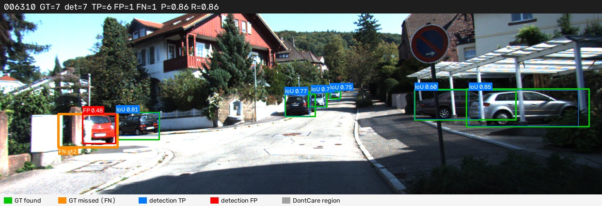

| what | status | conf | iou | gt | reason |
|---|---|---|---|---|---|
| det 0 | TP | 0.894 | 0.847 | 3 |  |
| det 1 | TP | 0.83 | 0.596 | 4 |  |
| det 2 | TP | 0.823 | 0.815 | 1 |  |
| det 3 | FP | 0.823 | 0.482 | 2 | poor localisation (IoU 0.48 with GT car 2) |
| det 4 | TP | 0.807 | 0.771 | 0 |  |
| det 5 | TP | 0.774 | 0.773 | 5 |  |
| det 6 | TP | 0.729 | 0.75 | 6 |  |
| GT 2 | FN |  | 0.482 | 2 | car detection overlaps only with IoU 0.48 < 0.5, largely occluded |

### 006312  -  P=0.67  R=0.75

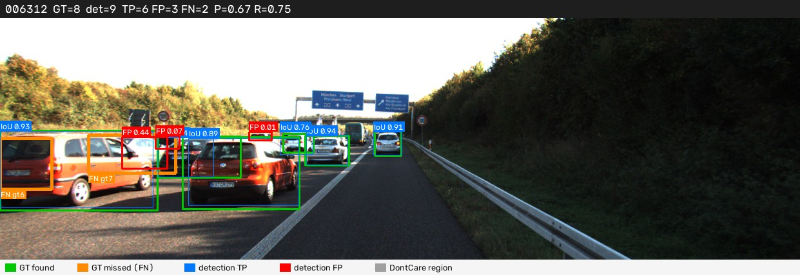

| what | status | conf | iou | gt | reason |
|---|---|---|---|---|---|
| det 0 | TP | 0.903 | 0.886 | 2 |  |
| det 1 | TP | 0.903 | 0.933 | 1 |  |
| det 2 | TP | 0.834 | 0.936 | 4 |  |
| det 3 | TP | 0.785 | 0.915 | 0 |  |
| det 4 | TP | 0.767 | 0.638 | 3 |  |
| det 5 | FP | 0.728 | 0.435 | 7 | poor localisation (IoU 0.44 with GT car 7) |
| det 6 | TP | 0.702 | 0.76 | 5 |  |
| det 7 | FP | 0.382 | 0.075 | 7 | small, unlabelled object (20 px high) - possibly a real car missing in GT |
| det 8 | FP | 0.335 | 0.008 | 2 | small, unlabelled object (13 px high) - possibly a real car missing in GT |
| GT 6 | FN |  | 0.227 | 6 | car detection overlaps only with IoU 0.23 < 0.5, truncated at image border (75%) |
| GT 7 | FN |  | 0.435 | 7 | car detection overlaps only with IoU 0.44 < 0.5, largely occluded |

### 006315  -  P=0.22  R=1.00

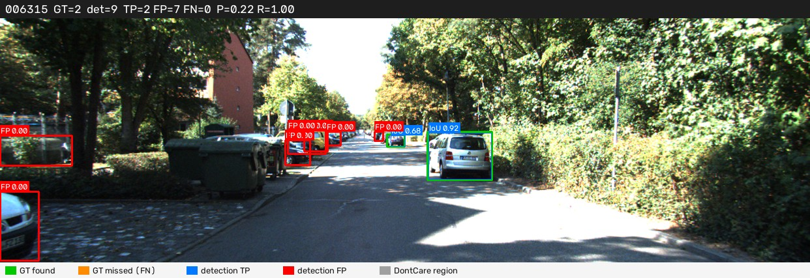

| what | status | conf | iou | gt | reason |
|---|---|---|---|---|---|
| det 0 | TP | 0.897 | 0.92 | 0 |  |
| det 1 | FP | 0.874 | 0.0 |  | no GT object here - unlabelled car or false alarm (check image) |
| det 2 | TP | 0.514 | 0.679 | 1 |  |
| det 3 | FP | 0.512 | 0.0 |  | no GT object here - unlabelled car or false alarm (check image) |
| det 4 | FP | 0.502 | 0.0 |  | no GT object here - unlabelled car or false alarm (check image) |
| det 5 | FP | 0.442 | 0.0 |  | Van in full KITTI labels (not a 'Car') |
| det 6 | FP | 0.384 | 0.0 |  | Van in full KITTI labels (not a 'Car') |
| det 7 | FP | 0.368 | 0.0 |  | inside KITTI 'DontCare' region (unlabelled far/hidden vehicle) |
| det 8 | FP | 0.261 | 0.0 |  | inside KITTI 'DontCare' region (unlabelled far/hidden vehicle) |

### 006329  -  P=0.60  R=1.00

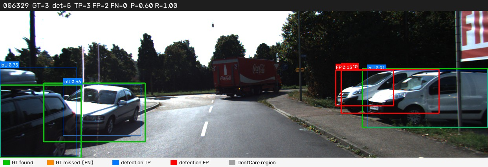

| what | status | conf | iou | gt | reason |
|---|---|---|---|---|---|
| det 0 | TP | 0.909 | 0.663 | 2 |  |
| det 1 | TP | 0.885 | 0.914 | 0 |  |
| det 2 | FP | 0.797 | 0.403 | 0 | poor localisation (IoU 0.40 with GT car 0) |
| det 3 | TP | 0.68 | 0.753 | 1 |  |
| det 4 | FP | 0.35 | 0.134 | 0 | poor localisation (IoU 0.13 with GT car 0) |

### 006374  -  P=1.00  R=1.00

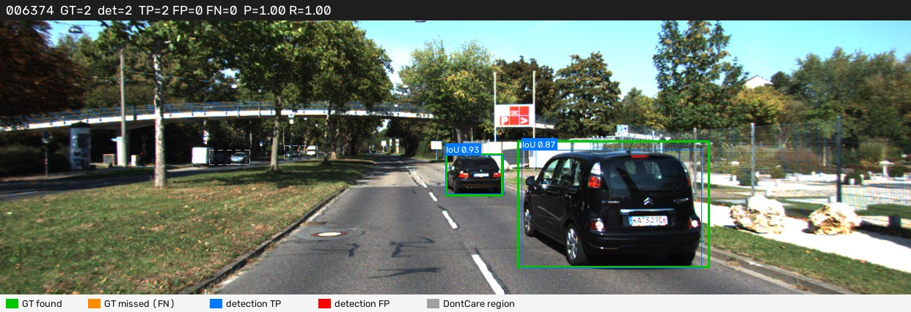

| what | status | conf | iou | gt | reason |
|---|---|---|---|---|---|
| det 0 | TP | 0.925 | 0.868 | 1 |  |
| det 1 | TP | 0.875 | 0.929 | 0 |  |
